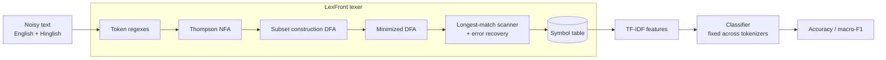

# Version 2 — LexFront proposal

*Status: frozen. Do not edit; add a new version file when the design changes.*

## What it is
The original project proposal. A compiler-style lexical analyzer (token classes
written as regexes, compiled to a Thompson NFA, then a DFA, then a minimized
DFA, with a symbol table and error recovery) used as a pre-tokenizer for noisy
text classification.

| Item | Value |
|---|---|
| Languages | English and **Hinglish** (romanized Hindi mixed with English) |
| Datasets | 4 (one of them Hinglish) |
| Comparison | LexFront against existing tokenizers, classifier held fixed |
| Packaging | Docker (CPU and GPU compose files) |

## Architecture

## Why we move on
See `v3-english-three-datasets.md`: Hinglish needs its own annotated data and
slang handling, which does not fit the available time, and the fourth dataset
was dropped with it.
