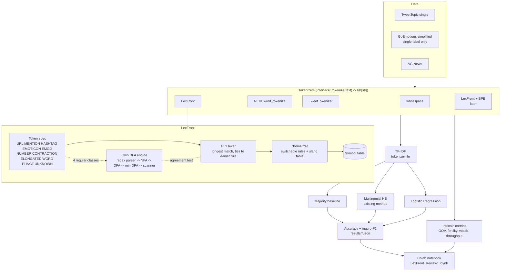

# Version 3 — English only, three datasets, five tokenizers

*Status: current. Do not edit once superseded; add a v4 file instead.*

## Changes from v2
| Item | v2 | v3 |
|---|---|---|
| Language | English + Hinglish | **English only** |
| Datasets | 4 | **3** (TweetTopic, GoEmotions single-label, AG News) |
| Tokenizers compared | existing tokenizers + LexFront | **5**: whitespace, NLTK `word_tokenize`, `TweetTokenizer`, LexFront, and LexFront + BPE hybrid (planned) |
| Packaging | Docker | **Docker dropped**; plain Python 3.11, CPU only |
| Presentation | – | **Google Colab notebook** |

Five-tokenizer line-up: the first four exist in the review-1 scope (Modules 1
and 2). BPE and the LexFront + BPE hybrid are planned for later and are *out of
scope for review 1*.

## Architecture

## Scope for review 1 (30–40 %)
Module 1 (data, three baseline tokenizers, three classifiers) and Module 2
(LexFront, own DFA engine, intrinsic metrics, LexFront + NB/LR).
Out of scope today: BPE, LexFront + BPE hybrid, WordPiece, Unigram, ablation,
transformers.
