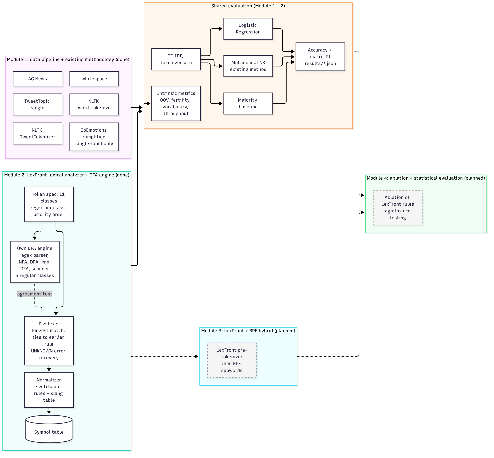
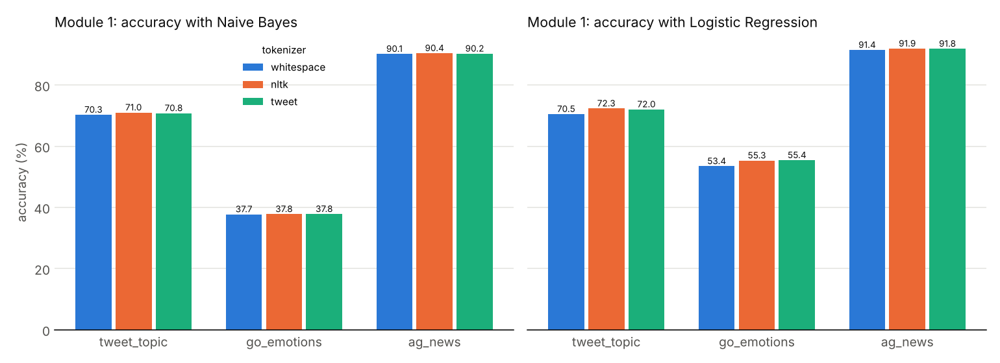
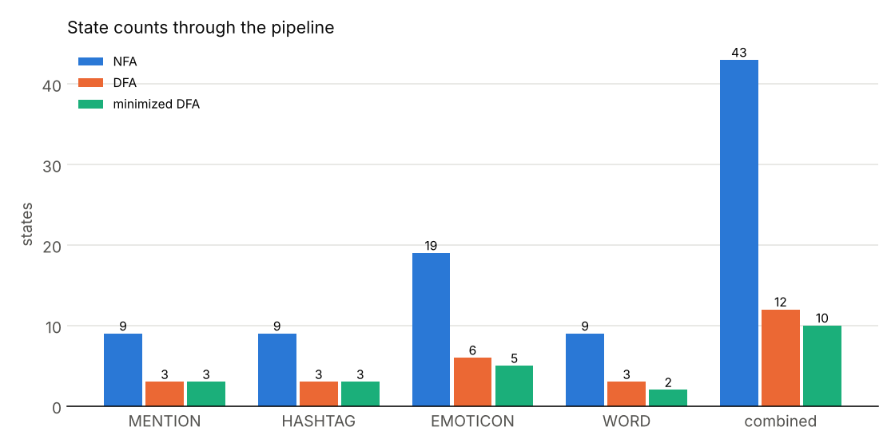
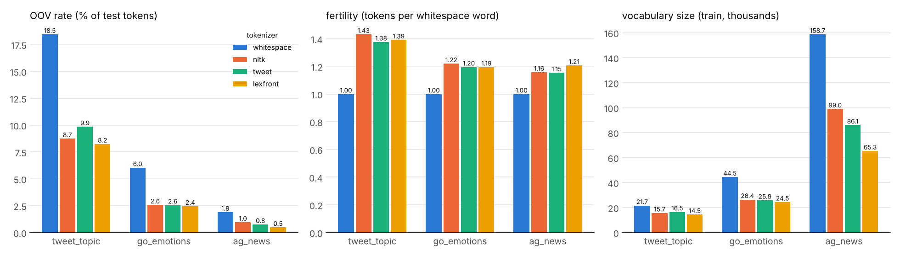
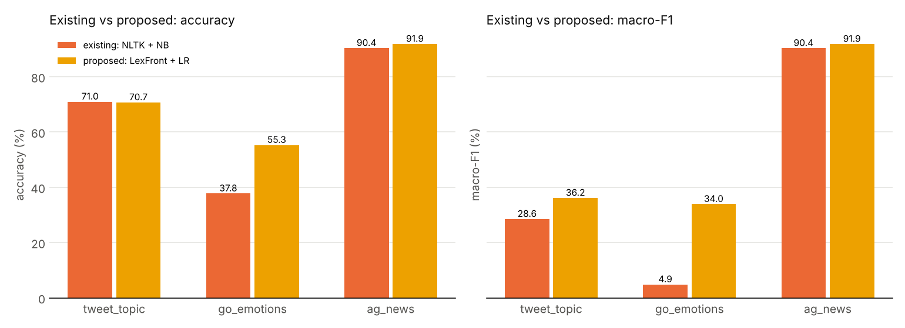

# Abstract

Noisy English text such as tweets and online comments contains URLs, @mentions, hashtags, emoticons, elongated words and slang that general-purpose tokenizers either split apart or leave unnormalized. LexFront is a compiler-style lexical analyzer used as a pre-tokenizer for text classification. Token classes are written as regular expressions with priorities and scanned by longest match, with an UNKNOWN error-recovery path, followed by a normalizer and a symbol table. For four regular token classes we also built our own regex-to-NFA-to-DFA-to-minimized-DFA pipeline; the combined automaton goes from 43 NFA states to 12 DFA states and 10 minimized states. This report covers Modules 1 and 2. We compare whitespace splitting, NLTK `word_tokenize`, NLTK `TweetTokenizer` and LexFront on TweetTopic, GoEmotions and AG News, holding TF-IDF features and the classifier fixed. LexFront has the lowest out-of-vocabulary rate and the smallest vocabulary on all three datasets, although part of that follows from its design. In classification, LexFront with Logistic Regression beats the existing NLTK with Naive Bayes setup by 17.54 accuracy points on GoEmotions and 1.49 on AG News, and is 0.26 points lower on TweetTopic. Almost all of that difference comes from changing the classifier; with the classifier held fixed, tokenizer differences are small. All results are single runs. A BPE hybrid, an ablation and significance testing are planned for later modules.

# 1. Introduction

## 1.1 Problem and motivation

Text classifiers need tokens. For clean prose, a general tokenizer is usually good enough. Social media text is different. A single tweet can contain a URL, an @mention, a hashtag, an emoticon, a number, an elongated word such as "sooooo" and slang such as "idk". A tokenizer that splits `https://t.co/x1` at the colon, or breaks `:-)` into three punctuation marks, hands the classifier fragments that carry little meaning.

Compiler design has a mature answer to a very similar problem. A compiler's lexical analyzer turns a character stream into tokens using one regular expression per token class, longest-match scanning, a priority rule for ties, and an error path for characters that fit no class. This project asks a measured question: if we tokenize noisy English text with a compiler-style lexer plus a normalizer, does a downstream classifier do better than with the usual tokenizers when everything else is held fixed?

## 1.2 Base paper and its weaknesses

The project starts from a blog-classification paper that uses a classic bag-of-words pipeline: NLTK tokenization, the Porter stemmer {{porter}}, scikit-learn's `CountVectorizer` {{pedregosa}} and a Multinomial Naive Bayes classifier {{mccallum}}. As quoted by the team, it reaches 35% accuracy on 40 labels and 54% after merging the labels to 3 (see `docs/versions/v1-base-paper.md`). We did not re-run this version, and its numbers are not comparable with ours, because the corpus and label sets differ. [TEAM: add the base-paper citation (title, authors, venue, URL). It could not be identified from the repository or by web search in this session, so it is not in the reference list.]

From the setup as described, we see these weaknesses:

- The tokenizer is treated as a fixed, uninteresting preprocessing step. It is never varied, so the paper cannot say how much tokenization matters.
- A general tokenizer followed by a word stemmer is not designed for tokens such as URLs, mentions, hashtags and emoticons.
- Only one classifier family (Naive Bayes on word counts) is used, so an effect of the features cannot be separated from an effect of the classifier.
- The figures we have are accuracy only. Accuracy alone can hide poor performance on small classes when labels are imbalanced.
- The large gap between 40 labels and 3 merged labels shows that the label design drives the result, which makes the setup hard to use for comparing tokenizers.

## 1.3 Our contribution

LexFront is a compiler-style lexical analyzer used as a pre-tokenizer for noisy-text classification, together with a controlled comparison against existing tokenizers. We do not claim a new tokenization algorithm. Regex-based tweet tokenizers already exist, for example NLTK's `TweetTokenizer` {{nltk_tweet}} and the CMU Twitter tokenizer (Twokenize) packaged with the CMU tagger {{gimpel,owoputi}}. Automaton-based tokenizers also exist, for example Fast WordPiece {{song}}. Our contribution is narrower and measurable:

1. A formal token specification (11 token classes in priority order, longest match, UNKNOWN error recovery), a normalizer with switchable rules, and a symbol table.
2. Our own regex-to-NFA-to-DFA-to-minimized-DFA engine for four regular token classes, tested against the PLY-based lexer {{ply}} that the experiments actually use.
3. A comparison of four tokenizers on three datasets with TF-IDF and the classifier held fixed, with both intrinsic metrics (OOV rate, fertility, vocabulary size, throughput) and classification metrics (accuracy, macro-F1).
4. A decomposition of the "existing vs proposed" difference into a tokenizer effect and a classifier effect.

## 1.4 Version history

The design changed twice before Review 1. Each version is frozen in `docs/versions/`, and the changelog records the change. Table 1 summarizes the versions and Figures 1 to 3 show their architecture diagrams.

Table: Table 1. Version history of the project design.

| Version | What changed | Why |
|:-----|:----------------------|:----------------------|
| v1, base paper (reference only) | NLTK tokenizer, PorterStemmer, CountVectorizer, Multinomial Naive Bayes on blog posts. Not re-run by us. | Starting point. The tokenizer is a fixed preprocessing step. |
| v2, LexFront proposal | Compiler-style lexer (regexes, Thompson NFA, subset-construction DFA, minimized DFA, longest-match scanner, error recovery, symbol table) as a pre-tokenizer. English and Hinglish, 4 datasets, comparison against existing tokenizers with the classifier fixed, Docker packaging. | Test whether a lexer designed for noisy text beats general tokenizers at the tokenization step, with everything else held fixed. |
| v3, current | English only; 3 datasets (TweetTopic, GoEmotions single-label, AG News); five tokenizers (whitespace, NLTK `word_tokenize`, `TweetTokenizer`, LexFront, LexFront + BPE planned); Docker dropped in favour of plain Python 3.11 on CPU; Google Colab notebook for presentation. | Hinglish needs its own annotated data and slang handling, which does not fit the available time, and the fourth dataset was dropped with it. [MISSING: reason for dropping Docker; it is not recorded in `docs/versions/v3-english-three-datasets.md`.] |

{width=16cm}

**Inference.** Figure 1 shows a straight pipeline in which the tokenizer is one box among several and is not varied. Every later version keeps the same downstream stages (features, classifier, accuracy) and changes only what happens before them.

{width=16cm}

**Inference.** Figure 2 puts the whole lexer pipeline (token regexes, NFA, DFA, minimized DFA, scanner with error recovery, symbol table) in front of the same TF-IDF and classifier stages. The classifier is labelled "fixed across tokenizers", which is the design rule that the later experiments follow.

{height=17cm}

**Inference.** Figure 3 shows five tokenizers feeding one TF-IDF vectorizer and three classifiers, with intrinsic metrics measured on the tokenizers directly. It marks "LexFront + BPE" as later work. It also shows that the DFA engine covers four regular classes and is checked against the PLY lexer by an agreement test, rather than replacing it.

# 2. Literature Survey

This survey is limited to works whose pages we opened and checked while writing. It is not exhaustive. For each entry we say what the work did and how it relates to LexFront.

## 2.1 Tokenization and Subword Methods

- **Byte-pair encoding for rare words.** Sennrich et al. {{sennrich}} represent rare and unseen words as sequences of subword units learned by merging frequent symbol pairs, for neural machine translation. LexFront learns no vocabulary; BPE is the method planned for the LexFront + BPE hybrid of Module 3.
- **Subword regularization and the unigram model.** Kudo {{kudo}} trains translation models on several sampled segmentations of the same sentence, using a unigram language model to propose segmentations. It is an alternative subword method to BPE and is outside the Review 1 scope.
- **SentencePiece.** Kudo and Richardson {{kudorichardson}} describe a language-independent subword tokenizer and detokenizer that works directly on raw text. It is relevant to how the subword step of Module 3 can be implemented.
- **Wordpieces in neural machine translation.** Wu et al. {{wu}} describe Google's translation system, which divides words into a limited set of common sub-word units. It is an early large-scale use of the wordpiece idea that BERT later adopted.
- **BERT.** Devlin et al. {{devlin}} pre-train a deep bidirectional transformer on subword input. Transformers are out of scope for Review 1; the point for LexFront is that most modern models start from a learned subword vocabulary, not from hand-written token classes.
- **Fast WordPiece.** Song et al. {{song}} give a linear-time WordPiece algorithm inspired by Aho-Corasick, and fold pre-tokenization and WordPiece into a single pass for general text. This shows that automaton-based tokenization already exists. It differs from LexFront in what the automaton encodes: a learned subword vocabulary there, hand-written token-class regexes with priorities and error recovery here.
- **BPE-dropout.** Provilkov et al. {{provilkov}} randomly drop merges during BPE segmentation to produce several segmentations of a word during training. It is another example of treating segmentation as a design choice that can be varied.
- **BPE versus unigram for pretraining.** Bostrom and Durrett {{bostrom}} compare BPE and unigram-model tokenization for language-model pretraining and report that the unigram method aligns better with morphology. It supports comparing tokenizers experimentally, which is what this project does.
- **How good is your tokenizer?** Rust et al. {{rust}} compare multilingual and monolingual language models and find that the choice of a dedicated monolingual tokenizer matters alongside pretraining data size. This supports our premise that the tokenizer should be treated as an experimental variable.
- **Survey of open-vocabulary modeling.** Mielke et al. {{mielke}} trace the move from word-level models to subword methods and conclude that no single tokenization method suits every application. They give the background for the planned subword module.
- **Tokenization-free modeling.** Clark et al. {{clark}} present Canine, an encoder that reads characters without a tokenization step. It sits at the opposite end from LexFront: no explicit tokens at all, whereas LexFront keeps explicit, inspectable tokens.
- **Textbook background.** The current draft of Jurafsky and Martin {{slp3}} devotes its Chapter 2 to "Words and Tokens". We use it as general background on word and subword tokenization.

## 2.2 Social Media Text Processing and Normalization

- **CMU Twitter tagger and tokenizer.** Gimpel et al. {{gimpel}} develop a tagset, annotated data and features for part-of-speech tagging of tweets, and package a modified Twitter tokenizer with the tagger, which later work calls twokenize {{owoputi}}. It is an existing tweet tokenizer of the kind LexFront is compared with in spirit; we do not compare against it in code in Review 1.
- **Improved tagging and a rewritten Twokenize.** Owoputi et al. {{owoputi}} add word clusters to the tagger and describe a rewritten rule-based tokenizer, emoticon detector and URL detector (twokenize) built from a regular-expression grammar. This is close to LexFront's design for emoticons and URLs, so we do not claim that handling them with regular expressions is new.
- **NLTK TweetTokenizer.** The NLTK documentation {{nltk_tweet}} describes `TweetTokenizer` as a tokenizer that builds a compiled regular expression from an ordered list of patterns and can shorten repeated characters. It is one of our three baseline tokenizers.
- **NER in tweets.** Ritter et al. {{ritter}} observe that the performance of standard NLP tools degrades on tweets and rebuild the pipeline for tweets. It motivates tweet-aware processing as a whole, of which tokenization is one stage.
- **Lexical normalisation.** Han and Baldwin {{hanbaldwin}} detect ill-formed words in short messages and generate correction candidates from morphophonemic similarity. LexFront's normalizer is much simpler, a 30-entry slang table and fixed rules, and does not detect misspellings.
- **Bad language on the internet.** Eisenstein {{eisenstein}} surveys the NLP response to non-standard text, which has followed two paths, normalization and domain adaptation. LexFront belongs to the normalization path.
- **WNUT 2015 shared tasks.** Baldwin et al. {{baldwin}} report shared tasks on Twitter lexical normalization and named-entity recognition. They show that normalization of user-generated text is an established task with its own evaluation, which our small normalizer does not yet address.
- **TweetEval.** Barbieri et al. {{barbieri}} provide a unified benchmark for tweet classification tasks. It is the kind of benchmark on which a pre-tokenizer could later be tested.
- **BERTweet.** Nguyen et al. {{nguyen}} release a large-scale pre-trained language model for English tweets. It handles the noisy-text problem by pre-training on tweets, while LexFront handles it with rules before a classical classifier.
- **Tweet topic classification.** Antypas et al. {{antypas}} introduce a tweet topic classification task with two datasets. One of them is TweetTopic, which we use, with the split described in Section 4.1.
- **GoEmotions.** Demszky et al. {{demszky}} release a dataset of fine-grained emotions, which we use as our second dataset. Its 28 labels in the simplified configuration make it the hardest of our three classification tasks.

## 2.3 Finite Automata and Lexical Analysis in NLP

- **Regular-expression search.** Thompson {{thompson}} gave the regular-expression search algorithm that is the origin of the NFA construction named after him. Our engine builds a Thompson-style NFA from each token regex.
- **Maximal-munch tokenization.** Reps {{reps}} shows that the standard textbook longest-match scanning algorithm can take quadratic time for some token definitions, and that linear time is always achievable. Our scanner uses the simple "remember the last accepting position" method and has not been optimized for this case.
- **Finite-state transducers.** Mohri {{mohri}} presents finite-state transducers for language and speech processing, including determinization and minimization algorithms. It is an NLP reference for determinizing and minimizing automata, which our engine does for its token DFA.
- **PLY.** The PLY documentation {{ply}} states that function-defined rules are tried in file order and that string-defined rules are sorted by decreasing regex length. This is ordered alternation, not longest match, so we add a dispatcher rule that tries every class and keeps the longest match (Section 3.2).
- **Automaton-based WordPiece.** As noted in Section 2.1, Song et al. {{song}} use a trie with failure links, an automaton, to make WordPiece linear. It is the closest published example of automaton-based tokenization for NLP that we found.

For subset construction and Moore minimization we follow standard compiler-textbook treatments. [TEAM: add the course textbook citation for these algorithms; it was not verified in this session.]

**Research gap.** Regex tweet tokenizers (Twokenize, `TweetTokenizer`), normalization methods and automaton-based subword tokenizers all exist. In the works we reviewed, we did not find a side-by-side measurement of a compiler-style lexer with a normalization layer against standard tokenizers on several noisy-text classification datasets, with the classifier held fixed and with the tokenizer effect separated from the classifier effect. This project fills that narrow gap. Our survey is not exhaustive, so this is a statement about what we reviewed, not a claim that no such study exists.

# 3. Proposed System

LexFront is organized as four modules. Modules 1 and 2 are complete and are reported here; Modules 3 and 4 are planned. Figure 4 shows the current architecture, which is the version-3 design (Figure 3) regrouped by module. Every tokenizer, existing or new, exposes the same interface, `tokenize(text) -> list[str]`, and feeds the same TF-IDF vectorizer. Only the tokenizer changes between runs.

{width=16.5cm}

**Inference.** Figure 4 shows two completed modules feeding one shared evaluation stage, and two planned modules attached to it. The shared stage is why a tokenizer comparison is possible at all: the vectorizer, the three classifiers and the metrics do not change from one tokenizer to the next.

## 3.1 Module 1: Data Pipeline and Existing Methodology

Module 1 compares three existing tokenizers with the classifier pipeline held fixed.

- **Datasets.** Loaders for `cardiffnlp/tweet_topic_single`, `google-research-datasets/go_emotions` (the `simplified` configuration, keeping only single-label examples) and `fancyzhx/ag_news`, using the Hugging Face `datasets` library {{lhoest}}. Each loader returns train and test texts, labels, label names and a record of which splits were used and why. TweetTopic's repository uses a loading script that the installed library version refuses to run, so the loader reads the same files from the automatically converted Parquet revision of the repository. The dataset card confirms the COLING 2022 split pair {{antypas}}, which is the one used.
- **Tokenizers.** Whitespace split, NLTK `word_tokenize` {{loper}} and NLTK `TweetTokenizer` {{nltk_tweet}}.
- **Features.** TF-IDF {{sklearn_tfidf}} with the tokenizer passed in as a function (`tokenizer=fn, token_pattern=None`), `lowercase=True` (the library default) and `min_df=2`. Because the vectorizer lowercases first, every tokenizer sees lowercased text.
- **Classifiers.** A majority-class baseline, Multinomial Naive Bayes (the method of the base paper, here on TF-IDF rather than raw counts) and Logistic Regression (`max_iter=1000`, seed 0), all from scikit-learn {{pedregosa}}. Naive Bayes and linear classifiers on bag-of-words features are standard baselines for topic classification {{wangmanning}}.
- **Metrics and records.** Accuracy and macro-F1. Each run is written to one JSON file with its full configuration, timings and library versions. All tables and figures in this report are built from those files.

Pseudocode for the dataset loaders and the evaluation loop:

```text
load(dataset):
    read the Hugging Face dataset (TweetTopic: parquet revision of the repository)
    keep the recommended split pair and record it in split_info
        TweetTopic: train_coling2022 / test_coling2022
        GoEmotions: simplified configuration, keep examples with exactly one label
    optionally subsample train/test with a fixed seed   # not used in this report
    return train texts, test texts, labels, label names, split_info

evaluation loop:
    for dataset in [tweet_topic, go_emotions, ag_news]:
        ds <- load(dataset)
        for tokenizer in [whitespace, nltk, tweet]:          # Module 2 adds: lexfront
            X_train <- TfidfVectorizer(tokenizer, token_pattern=None,
                                       lowercase=True, min_df=2).fit_transform(train)
            X_test  <- vectorizer.transform(test)
            for clf in [majority, naive_bayes, logistic_regression]:
                clf.fit(X_train, y_train)
                record <- {config, accuracy(y_test, clf.predict(X_test)),
                           macro_f1(...), timings, library versions}
                write record to results/<module>/<dataset>__<tokenizer>__<clf>.json
    tables, figures and observations are built only from those JSON files
```

## 3.2 Module 2: LexFront Lexical Analyzer and DFA Engine

LexFront is written the way a compiler front end is written. Its parts are:

- **Token specification** (Table 2). One regular expression per token class, listed in priority order. At each position the longest match over all classes wins, and ties go to the earlier class. UNKNOWN has no pattern; it is the error-recovery fallback.
- **PLY lexer.** The production lexer is built with PLY {{ply}}. Because PLY's own master regex is an ordered alternation (first match wins), we register one catch-all PLY rule whose body tries every class and keeps the longest match, with ties to the earlier class. PLY still provides the token stream, positions, ignored whitespace and the `t_error` hook. A character that no class accepts becomes an UNKNOWN token and scanning continues after it (panic-mode recovery).
- **Normalizer.** A semantic action applied to each token, with six rules that can each be switched off: URL to `<URL>`, MENTION to `<USER>`, NUMBER to `<NUM>`, runs of three or more identical letters shortened to two, lowercasing of word-like tokens, and slang lookup in a 30-entry table (for example `u` to `you`, `idk` to `i do not know`). A slang entry can expand to several tokens.
- **Symbol table.** Maps each normalized token to an id, a frequency and a class. The first sighting assigns the id. The classification pipeline does not use it; TF-IDF builds its own vocabulary.
- **`LexFront.tokenize()`.** Runs scanner, normalizer and optional symbol table, and returns a list of strings, the same interface as the baselines.
- **Own DFA engine.** A regex parser, Thompson NFA, subset construction, Moore minimization and a table-driven longest-match scanner with UNKNOWN recovery. The Unicode range is split into alphabet atoms at every range boundary used by a rule, so the transition table has one column per atom rather than one per code point. The engine covers EMOTICON, HASHTAG, MENTION and WORD. A test checks that the DFA scanner and the PLY lexer give identical tokens on these four classes. The DFA engine is not on the production path; the experiments use the PLY lexer.
- **ELONGATED is not in the DFA engine.** Its regex needs a back-reference (a letter repeated three or more times), which is outside the regular-expression formalism, so our regex parser rejects it.

Table: Table 2. LexFront token classes in priority order (from `lexer/token_spec.py`). "DFA" marks the classes also compiled by our own engine.

| Class | What it matches | DFA |
|:--------------|:----------------------------------------------------|:----:|
| URL | `http(s)://` or `www.` up to the last URL-like character | no |
| MENTION | `@` followed by letters, digits or `_` | yes |
| HASHTAG | `#` followed by letters, digits or `_` | yes |
| EMOTICON | `:`, `;` or `=`, an optional `-` or `'`, then one of `) ( D d P p / ] [` or the vertical bar; and `<3` | yes |
| EMOJI | one emoji symbol with optional variation or skin-tone modifier | no |
| NUMBER | digits with optional `.` or `,` groups (`1`, `3.5`, `1,000`) | no |
| CONTRACTION | letters, an apostrophe, then `t s re ve ll d m` (`don't`, `we're`); uses look-ahead | no |
| ELONGATED | a letter repeated three or more times inside a word; needs a back-reference | no |
| WORD | a letter followed by letters or digits (`gr8`, `covid19`) | yes |
| PUNCT | one punctuation character | no |
| UNKNOWN | any character no other class accepts (error recovery) | no |

Two design details matter for reading the results. First, WORD may contain digits after its first letter, while NUMBER starts with a digit, so `5pm` becomes NUMBER `5` plus WORD `pm`. Second, Python's `re` is greedy; for the four classes in the DFA engine the agreement test shows that greedy matching equals longest matching, but we have not proved this for the other classes. For subset construction and Moore minimization we use standard textbook algorithms. [TEAM: add the course textbook citation; see Section 2.3.]

**(a) Regex to NFA to DFA to minimized DFA**

```text
input : rules = [(name_0, regex_0), ..., (name_k, regex_k)]   # list order = priority
output: scanner tables

asts   <- [parse(regex_i) for each rule]                       # recursive descent
atoms  <- split the code-point line at every range boundary used in asts
NFA    <- new start state
for i, ast in asts:
    (s, t) <- thompson(ast)          # sym: s -a-> t | cat: chain with eps
                                     # alt: s -eps-> each branch -eps-> t
                                     # star/plus/opt: eps loop / skip edges
    add eps edge  NFA.start -> s
    accepting[t]  <- i
start_set <- eps_closure({NFA.start})
DFA.states <- {start_set};  worklist <- [start_set]
while worklist not empty:
    S <- pop(worklist)
    for each atom a:
        T <- eps_closure(move(S, a))
        if T is empty: continue
        if T is new: add to DFA.states and worklist
        DFA.trans[S][a] <- T
for each DFA state S:
    S.accepts <- min{accepting[q] : q in S and q accepting}   # priority; None if none
# Moore minimization
block[S] <- id of (S.accepts)             # initial partition: by accepted rule
repeat
    signature[S] <- (block[S], sorted (a, block[DFA.trans[S][a]]) pairs)
    block'[S]    <- id of signature[S]
until number of blocks stops growing
merge states with equal block; renumber breadth-first from the start state
```

**(b) Longest-match scanner with error recovery**

```text
scan(text):
    pos <- 0
    while pos < len(text):
        if text[pos] is whitespace: pos++ ; continue
        state <- start;  last <- none;  i <- pos
        while i < len(text):
            a <- atom_of(text[i])
            state <- table[state][a]            # DEAD if no edge
            if state == DEAD: break
            i++
            if accepts[state] is not none: last <- (i, accepts[state])
        if last is none:                        # error recovery (panic mode)
            emit (UNKNOWN, text[pos]);  pos++
        else:
            (end, rule) <- last
            emit (class[rule], text[pos:end]);  pos <- end
# PLY version: same loop, but the table walk is replaced by trying every class regex
# at pos and keeping the strictly longest match, so that ties stay with the earlier class.
```

## 3.3 Module 3: Subword Hybrid (BPE, LexFront + BPE) [Planned]

Module 3 will add a byte-pair-encoding tokenizer {{sennrich}} and a hybrid in which LexFront first produces its token classes and normalized tokens, and BPE then splits the remaining word-like tokens into subwords. The aim is to see whether LexFront's handling of URLs, mentions, hashtags and emoticons combines usefully with subword coverage of rare words. This module is not started and no result from it appears in this report.

## 3.4 Module 4: Ablation and Statistical Evaluation [Planned]

Module 4 will switch LexFront's normalization rules on and off one at a time (the normalizer already exposes a switch for each rule), run multiple seeds, and test whether differences between tokenizers are statistically significant. It will also isolate the lowercase rule, which is currently redundant in the experiments because the TF-IDF vectorizer lowercases text before the tokenizer sees it (Section 5.4). This module is not started and no result from it appears in this report.

# 4. Results and Implementation

All numbers in this section are read from the JSON files in `results/` (full datasets, seed 0, no subsampling). The tables are generated from those files by `experiments/report.py`, and we re-generated them from the JSON before writing this report and confirmed that they match the committed table files. The notebook `notebooks/LexFront_Review1.ipynb` has a fast `QUICK_MODE` on a subsample; its output is not used for any number in this report.

## 4.1 Dataset Description

TweetTopic {{antypas}} contains tweets labelled with one of six topics. GoEmotions {{demszky}} contains Reddit comments; we use the `simplified` configuration and keep only single-label examples. AG News {{zhang}} contains news snippets labelled with one of four topics.

Table: Table 3. Datasets and splits used (from `results/datasets.json`).

@@TABLE:datasets:11,17,13,13,7,7,6,8,10@@

**Inference.** The three datasets differ a lot in size, from the smallest training set (tweet_topic) to the largest (ag_news), in number of labels (6, 28 and 4), and in class balance. The largest test class holds 40.01% of TweetTopic, 34.99% of GoEmotions and 25.00% of AG News, so a classifier that always predicts the most common class scores exactly those percentages. This is why the majority baseline is reported next to every result.

## 4.2 Module 1 Results

Table 4 gives accuracy and macro-F1 for the three existing tokenizers with each classifier. Figure 5 plots accuracy.

Table: Table 4. Module 1 results, accuracy / macro-F1 in %, single run (seed 0), full data.

@@TABLE:module1_results:9,10,13,15,15@@

{width=16cm}

**Inference.**

- Every trained classifier beats the majority baseline in accuracy on every dataset. On GoEmotions, Naive Bayes (37.73 to 37.80 accuracy) is only a little above the majority baseline (34.99), and its macro-F1 (4.86 to 4.93) is low next to Logistic Regression (31.23 to 33.99).
- Within each dataset, Logistic Regression is at least as accurate as Naive Bayes for every tokenizer. The LR-over-NB gap averaged over the three tokenizers is +0.93 points on tweet_topic, +16.94 on go_emotions and +1.46 on ag_news.
- Whitespace splitting is the lowest-accuracy tokenizer under Logistic Regression on all three datasets (70.49, 53.44 and 91.43). NLTK and `TweetTokenizer` are close to each other: the tokenizer spread under LR is 1.82 points on tweet_topic, 1.96 on go_emotions and 0.45 on ag_news, and under NB it is 0.74, 0.07 and 0.24.
- These are single runs without confidence intervals. Differences of about one point or less should not be read as real.

## 4.3 Module 2 Results

### Tokenizer comparison examples

Table 5 shows the output of the four tokenizers on five of the eight example tweets used in the notebook. The input is lowercased first, as the vectorizer does. Each token is shown in square brackets. These outputs come from the committed notebook run.

Table: Table 5. Tokens produced by each tokenizer on example tweets (input lowercased).

@@EXAMPLES@@

**Inference.**

- NLTK `word_tokenize` splits the URL in example 1 into `https`, `:` and `//t.co/abc123`, splits `@mike_93` into `@` and `mike_93`, and splits the emoticon `:)` into `:` and `)`. Example 4's `:-(` is split into three tokens.
- `TweetTokenizer` keeps URLs, mentions, hashtags and the emoticons in these examples whole, and leaves them unnormalized.
- LexFront also keeps them whole but replaces the URL with `<URL>` and the mention with `<USER>`, collapses `sooooo` to `soo`, expands `idk` and `tbh` and maps `gr8` to `great`, and in example 3 turns `gonna` into `going to` and `3-0` into `<NUM> - <NUM>`. The last change removes the score itself from the features.
- The 30-entry slang table is incomplete: `wont` in example 1 passes through unchanged.
- In example 7, the character `§` is not accepted by any token class, so LexFront emits it as UNKNOWN tokens (one per character) and continues scanning. This is the error-recovery path at work.

### DFA state counts

The four regular classes were compiled by our own engine. Table 6 gives the number of alphabet atoms and the NFA, DFA and minimized DFA states for each class and for the four classes combined into one automaton. Figure 6 draws the combined minimized DFA and Figure 7 plots the counts.

Table: Table 6. State counts through the regex-to-DFA pipeline (from `results/module2/dfa_states.json`).

@@TABLE:dfa_states:30,9,9,9,12@@

{width=15cm}

{width=13cm}

**Inference.**

- The combined automaton has 43 NFA states, 12 DFA states and 10 minimized states, over 31 alphabet atoms.
- Subset construction reduces every class to a handful of DFA states (MENTION 9 to 3, HASHTAG 9 to 3, EMOTICON 19 to 6, WORD 9 to 3).
- Minimization reduces EMOTICON from 6 to 5 states and WORD from 3 to 2, and leaves MENTION and HASHTAG at 3. The combined automaton goes from 12 to 10 states.
- Figure 6 has one accepting state for each of HASHTAG (q6), EMOTICON (q8), MENTION (q9) and WORD (q5), as expected for four classes.
- ELONGATED, written with a back-reference, is not accepted by our parser. Spelled out as 26 lowercase alternatives (an extra experiment, not part of LexFront), it compiles to 221 NFA, 157 DFA and 54 minimized states, which is much larger than the other classes.

### Intrinsic metrics

Out-of-vocabulary (OOV) rate is the share of test tokens (or test token types) not seen in training. Fertility is the number of tokens per whitespace-separated word. Vocabulary size is the number of distinct training tokens. Throughput is tokens per second on the machine that ran the experiments, so it only compares tokenizers with each other. All are measured on lowercased text.

Table: Table 7. Intrinsic metrics of the four tokenizers (from `results/module2/intrinsic__*.json` and the Module 1 tokenizers).

@@TABLE:intrinsic_metrics:9,10,10,10,9,9,13@@

{width=16.5cm}

**Inference.**

- LexFront has the lowest OOV rate on tokens and on types, and the smallest vocabulary, on all three datasets. On AG News its OOV rate is 0.48% (types 6.78%) against 0.96% (types 11.52%) for NLTK, and its vocabulary is 65337 against 98994 for NLTK.
- Whitespace splitting has the highest OOV rate and the largest vocabulary on every dataset.
- Fertility differs little among the three non-whitespace tokenizers. LexFront's is 1.391 on tweet_topic, 1.195 on go_emotions (equal to `TweetTokenizer`) and 1.207 on ag_news, where it is the highest of the three.
- Throughput: LexFront is 1.52 times NLTK's speed on tweet_topic, 1.19 times on go_emotions and 0.79 times on ag_news. Whitespace splitting is far faster than all three (11,774,749 tokens/s on tweet_topic). These are single timings on one machine.
- The lower OOV rate and smaller vocabulary are partly built in. Placeholders such as `<URL>` and `<NUM>`, collapsing elongated letters and expanding slang merge many different strings into fewer tokens, so they lower OOV by construction. These numbers alone do not show better classification.

## 4.4 Module 3 Results: Subword Hybrid [In progress]

Not yet available. Module 3 (LexFront + BPE) has not been run, and no number from it is reported here.

## 4.5 Module 4 Results: Ablation and Statistical Evaluation [In progress]

Not yet available. The ablation, multiple seeds and significance tests have not been run, and no number from them is reported here.

# 5. Performance and Metrics

## 5.1 Existing versus proposed, per dataset

"Existing" means NLTK `word_tokenize` with Naive Bayes, the combination closest to the base paper. "Proposed" means LexFront with Logistic Regression. Table 8 gives both, plus the two mixed cells (LexFront + NB and NLTK + LR), so that a change can be attributed to the tokenizer or to the classifier. Figure 9 plots the existing and proposed settings.

Table: Table 8. Existing (NLTK + NB) versus proposed (LexFront + LR), accuracy / macro-F1 in %, single run.

@@TABLE:existing_vs_proposed:9,13,13,8,8,13,13@@

{width=16cm}

**Inference.**

- Proposed over existing: accuracy +17.54 points on go_emotions and +1.49 on ag_news, but -0.26 on tweet_topic. Macro-F1 rises on all three: +7.62, +29.07 and +1.50 points.
- On tweet_topic, NLTK + LR (72.32 accuracy, 36.95 macro-F1) is higher than LexFront + LR (70.73, 36.18) on both metrics. On go_emotions and ag_news the two are almost identical in accuracy (55.29 and 55.32; 91.88 and 91.87).
- LexFront + NB is at or below NLTK + NB in accuracy on all three datasets (70.43 against 70.99, 37.78 against 37.78, 90.08 against 90.38).

## 5.2 Where the improvement comes from

Table 9 splits the accuracy change from "existing" to "proposed" into a classifier part and a tokenizer part. The values come from the unrounded accuracies in the JSON files, so a value can differ by 0.01 from a difference of the rounded numbers in Table 8.

Table: Table 9. Attribution of the accuracy change, in percentage points (from the JSON files).

| Dataset | Proposed minus existing | Classifier NB to LR (NLTK fixed) | Tokenizer NLTK to LexFront (LR fixed) | Tokenizer NLTK to LexFront (NB fixed) |
|:-----------|:-------:|:-------:|:-------:|:-------:|
| tweet_topic | -0.26 | +1.32 | -1.59 | -0.56 |
| go_emotions | +17.54 | +17.52 | +0.02 | +0.00 |
| ag_news | +1.49 | +1.50 | -0.01 | -0.30 |

**Inference.**

- On go_emotions, +17.52 of the +17.54 points come from switching the classifier. Changing only the tokenizer moves accuracy by +0.02 points with LR fixed and +0.00 with NB fixed.
- On ag_news, the classifier change is +1.50 points, essentially the whole +1.49 change; the tokenizer change is -0.01 (LR fixed) or -0.30 (NB fixed).
- On tweet_topic, the classifier change is +1.32 points, and the tokenizer change is negative, -1.59 with LR fixed and -0.56 with NB fixed.
- So in these runs the accuracy gain of "proposed over existing" comes from the classifier, not from the tokenizer.

## 5.3 Reading the intrinsic and classification results together

LexFront has the best OOV rate and vocabulary size on all three datasets (Table 7), yet with the classifier held fixed its accuracy is not clearly higher than that of NLTK or `TweetTokenizer` (Tables 4, 8 and 9). Under LR, relative to NLTK, it is -1.59 points on tweet_topic, +0.02 on go_emotions and -0.01 on ag_news. So a lower OOV rate did not translate into a visible classification gain here. Whether it matters on other data, or with other features, is not something these runs can say.

## 5.4 What these results do not show

1. **The accuracy gain comes mainly from the classifier, not the tokenizer.** Section 5.2 shows this on each dataset. The "proposed over existing" gain should not be presented as a tokenizer result.
2. **The results are single runs.** Each cell is one run with seed 0 and no confidence interval, so small differences, including every tokenizer-only difference in Table 9, cannot be called real or null. Significance testing is planned for Module 4.
3. **TF-IDF's lowercasing makes LexFront's lowercase rule redundant.** The vectorizer lowercases text before any tokenizer runs, so LexFront never sees upper case in these experiments, and its own lowercase rule is inactive. The rule is covered only by unit tests and the notebook demonstration. The ablation in Module 4 is meant to isolate this effect.
4. Naive Bayes here runs on TF-IDF weights, while the base paper used raw counts, so our NB is not an exact reproduction of the base paper's classifier. We did not run NB on counts.
5. The tweet_topic training set is small and its train/test split is a temporal one, so it is the noisiest of the three comparisons.

# 6. Conclusion

**What was achieved.** Modules 1 and 2 are implemented and tested. Module 1 gives a controlled evaluation pipeline over three datasets, three existing tokenizers and three classifiers, with one JSON record per run. Module 2 gives LexFront: an 11-class token specification, a longest-match PLY lexer with UNKNOWN error recovery, a normalizer with six switchable rules and a 30-entry slang table, a symbol table, and our own regex-to-minimized-DFA engine for four regular classes. The combined automaton minimizes from 43 NFA states to 10 DFA states. LexFront has the lowest OOV rate and smallest vocabulary on all three datasets.

**Limitations.**

- The accuracy gain of LexFront + Logistic Regression over NLTK + Naive Bayes comes mainly from the classifier. With the classifier fixed, LexFront is not measurably better than NLTK in these runs (Table 9).
- All results are single runs without confidence intervals.
- The lower OOV rate and smaller vocabulary are partly a consequence of placeholders, elongation collapsing and slang expansion.
- TF-IDF lowercasing makes LexFront's lowercase rule redundant in the experiments.
- The slang table is small, the normalizer does not correct misspellings, and `3-0` becomes `<NUM> - <NUM>`, which discards the score.
- The DFA engine covers four of the token classes, is checked against the PLY lexer but is not on the production path, and ELONGATED cannot be expressed as a regular expression without a back-reference.
- English only; Hinglish was dropped in version 3. Throughput was measured on one machine, with a pure-Python lexer that is not built for speed.
- The base-paper numbers are as quoted by the team and were not re-run.

**Next steps.** Module 3: add BPE and the LexFront + BPE hybrid. Module 4: ablate each normalization rule, including lowercase, run multiple seeds, and test significance of tokenizer differences. Two items in this report still need the team: the base-paper citation and the course-textbook citation for subset construction and Moore minimization.

# References

@@REFERENCES@@
